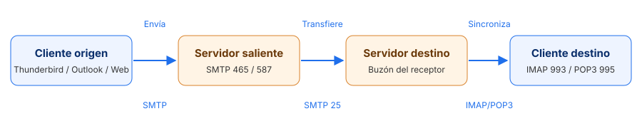

# 7.4 Correo y mensajería electrónica

En una empresa conviven dos formas de comunicarse: el **correo electrónico**, formal y asíncrono, y la **mensajería instantánea**, rápida y en tiempo real.

## 1. Correo frente a mensajería

| | Correo electrónico | Mensajería instantánea |
|---|---|---|
| Ritmo | Asíncrono: no exige respuesta inmediata | Síncrono: conversación en tiempo real |
| Formalidad | Alta: asunto, adjuntos, registro | Baja: chats y canales temáticos |
| Trazabilidad | Alta, queda constancia | Depende de la herramienta |
| Lo uso para | Comunicaciones oficiales, entregas, clientes | Coordinación rápida del equipo |

## 2. Cómo viaja un correo



| Protocolo | Para qué sirve | Puerto cifrado | Observaciones |
|---|---|---|---|
| **SMTP** | Enviar: del cliente al servidor y entre servidores | `465` (TLS implícito) / `587` (STARTTLS) | El `25` queda para servidor↔servidor |
| **IMAP** | Recibir **sincronizando** carpetas y estados en el servidor | `993` (SSL/TLS) | Opción recomendada: mismo buzón en varios dispositivos |
| **POP3** | Recibir **descargando** al equipo | `995` (SSL/TLS) | Por defecto borra del servidor; no sincroniza carpetas |

> [!IMPORTANT]
> El **RFC 8314** (2018) declara obsoleto el acceso sin cifrar para clientes (puertos `110` y `143` en claro) y da preferencia al TLS implícito (`465`, `993`, `995`) sobre STARTTLS (`587`). El puerto `25` es para la transferencia entre servidores (RFC 5321) y los proveedores domésticos suelen bloquearlo para frenar el spam.

## 3. Procedimiento: configurar un cliente de correo

**Herramienta:** Mozilla Thunderbird (software libre, MPL 2.0). Otras opciones: Outlook (propietario) o Evolution (libre, Linux).

1. Abrir Thunderbird → *Configuración de cuentas* → *Añadir cuenta de correo*.
2. Escribir nombre, dirección y pulsar **Configurar manualmente**.
3. Introducir los servidores. Ejemplo con Microsoft 365 / Exchange Online:

   | Dirección | Servidor | Puerto | Seguridad | Autenticación |
   |---|---|---|---|---|
   | Entrante (IMAP) | `outlook.office365.com` | `993` | SSL/TLS | OAuth2 |
   | Saliente (SMTP) | `smtp.office365.com` | `587` | STARTTLS | OAuth2 |

   En cuentas personales de Outlook.com el servidor saliente es `smtp-mail.outlook.com:587`.

4. Pulsar **Volver a probar** y después **Hecho**; se abrirá la ventana de inicio de sesión de Microsoft (OAuth 2.0).

> [!WARNING]
> Microsoft ha retirado la autenticación básica (usuario + contraseña) en IMAP/POP y la está retirando en SMTP AUTH. Si el cliente pide "contraseña normal" y falla, hay que elegir **OAuth2** como método de autenticación.

### Comprobar que los puertos responden

Antes de culpar al cliente, compruebo que puedo llegar al servidor.

**Windows (PowerShell):**

```powershell
Test-NetConnection outlook.office365.com -Port 993
Test-NetConnection smtp.office365.com -Port 587
```

Si funciona, la salida muestra `TcpTestSucceeded : True`.

**Linux:** además de la conexión, compruebo el certificado TLS.

```bash
# TLS implícito (IMAP 993)
openssl s_client -connect outlook.office365.com:993 -quiet

# STARTTLS (SMTP 587)
openssl s_client -connect smtp.office365.com:587 -starttls smtp -quiet
```

Una respuesta que empieza por `* OK` (IMAP) o `250` (SMTP) indica que el servidor contesta sobre un canal cifrado. Se sale con `Ctrl + C`.

<!-- CAPTURA: resultado de Test-NetConnection en tu equipo

-->

## 4. Buenas prácticas al enviar

### Para, CC y CCO

| Campo | Cuándo lo uso | ¿Quién ve las direcciones? |
|---|---|---|
| Para | Destinatarios que deben actuar | Todos los de Para y CC |
| CC | Personas que solo deben estar informadas | Todos los de Para y CC |
| CCO | Envíos a muchas personas externas | Nadie más: quedan ocultas |

> [!CAUTION]
> Si envío un aviso a varios clientes poniendo sus direcciones en Para o CC, **expongo datos personales** al resto: según la AEPD es una brecha de confidencialidad (RGPD, arts. 5.1.f y 32). En envíos múltiples externos uso siempre **CCO**.

### Organización del buzón

- En **IMAP/Outlook** cada correo vive en **una carpeta**.
- En **Gmail** se usan **etiquetas**: un mismo correo puede tener varias sin duplicarse.

## 5. Mensajería instantánea

| Ámbito | Herramientas | Nota |
|---|---|---|
| Empresa y desarrollo | Microsoft Teams, Slack, Google Chat | Integración con M365, GitHub, Jira… |
| Comunidades | Discord, Telegram, WhatsApp | Telegram solo cifra extremo a extremo en los *chats secretos* |
| Privacidad reforzada | Signal | Código libre (AGPLv3), cifrado extremo a extremo por defecto |

Regla básica: **nunca** envío contraseñas en texto plano ni datos de clientes por cuentas personales; uso los canales corporativos aprobados.


