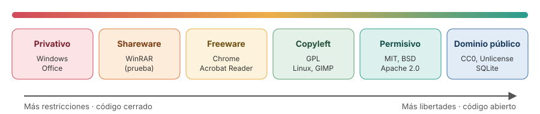

# 7.1 Clasificación y licencias de software

Antes de instalar o recomendar un programa hay que responder dos preguntas: **¿para qué sirve?** (su propósito) y **¿qué me deja hacer la ley con él?** (su licencia). En esta página resumo ambas clasificaciones y documento cómo comprobar la licencia real de un programa desde la terminal.

## 1. Clasificación por propósito

| Tipo | Función | Ejemplos |
|---|---|---|
| Software de sistema | Controla el hardware y sirve de base a todo lo demás | Windows, GNU/Linux, controladores, firmware UEFI/BIOS |
| Software de programación | Permite escribir, compilar, interpretar y depurar programas | VS Code, `gcc`, Python, depuradores |
| Software de aplicación | Resuelve una tarea concreta del usuario o de la empresa | Ofimática, navegadores, diseño, antivirus, ERP, juegos |

## 2. Qué es una licencia

Una licencia es un **contrato legal** entre el autor y el usuario. Fija qué derechos tengo (instalar, copiar, modificar, redistribuir), protege la autoría y evita conflictos legales. En el software comercial suele presentarse como **EULA** (*End-User License Agreement*), el texto que aceptamos al instalar.

> [!IMPORTANT]
> Pagar por un programa privativo **no me hace dueño del código**: compro un *permiso de uso* con condiciones. Y al revés, **libre no significa gratis**: el software libre se refiere a las libertades del usuario y puede venderse; el *freeware* es gratis pero normalmente cerrado.

### Las cuatro libertades del software libre

| Libertad | Me permite… | Requisito |
|---|---|---|
| 0 | Ejecutar el programa para cualquier propósito | — |
| 1 | Estudiar cómo funciona y adaptarlo | Acceso al código fuente |
| 2 | Redistribuir copias | — |
| 3 | Distribuir mis versiones modificadas | Acceso al código fuente |

Si además cumple la definición de la *Open Source Initiative*, se habla de **FOSS/FLOSS** (*Free/Libre and Open Source Software*).

## 3. Espectro de licencias



| Modelo | ¿Código disponible? | ¿Puedo modificar y redistribuir? | Ejemplos |
|---|:---:|---|---|
| Privativo | ❌ | No, salvo permiso expreso | Windows, Microsoft Office, Photoshop |
| Shareware / Trial | ❌ | No; prueba limitada y después pago | WinRAR |
| Freeware | ❌ | Uso gratis, redistribución controlada | Google Chrome, Adobe Acrobat Reader |
| Copyleft fuerte (GPL) | ✅ | Sí, pero lo derivado que distribuya debe seguir en GPL | Kernel Linux (GPLv2), GIMP (GPLv3+) |
| Copyleft débil (LGPL, MPL 2.0) | ✅ | Sí; se puede enlazar con software privativo | glibc (LGPL), LibreOffice y Thunderbird (MPL 2.0) |
| Permisivo (MIT, BSD, Apache 2.0) | ✅ | Sí, citando la autoría, incluso dentro de software privativo | Node.js (MIT), FreeBSD (BSD), Apache HTTP Server |
| Dominio público / CC0 | ✅ | Sin restricciones | SQLite, código bajo CC0 o The Unlicense |

**Casos mixtos que conviene conocer:**

- **Licencia dual:** MySQL se ofrece en GPLv2 o con licencia comercial de Oracle; eliges una.
- **Ecosistema mixto:** Android combina una base abierta (AOSP, Apache 2.0, y kernel Linux, GPLv2) con aplicaciones propietarias de Google.
- **Dominio público en España:** los derechos de explotación duran la vida del autor + 70 años (o 70 años desde la divulgación si el titular es una empresa). Como los derechos morales no se pueden ceder, para "regalar" código se usan dedicaciones como CC0 o The Unlicense.

### Licencias para documentación: Creative Commons

Las licencias de software regulan código; para **contenidos** (manuales, imágenes, vídeos) se usan las Creative Commons, que combinan cuatro condiciones: **BY** (atribución), **SA** (compartir igual), **NC** (no comercial) y **ND** (sin obras derivadas).

| Licencia | Uso comercial | Obras derivadas | Compartir igual |
|---|:---:|:---:|:---:|
| CC BY | ✅ | ✅ | No |
| CC BY-SA | ✅ | ✅ | ✅ |
| CC BY-NC | ❌ | ✅ | No |
| CC BY-ND | ✅ | ❌ | — |
| CC BY-NC-SA | ❌ | ✅ | ✅ |
| CC BY-NC-ND | ❌ | ❌ | — |
| CC0 | ✅ | ✅ | No |

> [!TIP]
> Este portfolio usa **CC BY-SA 4.0** para los textos. Las CC no se recomiendan para código fuente (salvo CC0), así que si el repositorio tuviera programas les pondría una licencia de software como MIT.

## 4. Procedimiento: comprobar la licencia de un programa

**Objetivo:** antes de instalar un programa en un equipo de la empresa, confirmar qué licencia tiene a partir de una fuente fiable (el gestor de paquetes), no de una web cualquiera.

### En Linux (Debian/Ubuntu)

1. Consultar la información del paquete instalado:

   ```bash
   dpkg -s git
   ```

2. Leer la cabecera del fichero de copyright que trae el propio paquete:

   ```bash
   cat /usr/share/doc/git/copyright | head -n 20
   ```

3. Buscar la línea `License:`, que usa identificadores **SPDX** (por ejemplo `GPL-2`, `MIT`, `Apache-2.0`).

### En Windows (PowerShell)

1. Consultar el manifiesto del paquete en `winget`:

   ```powershell
   winget show VideoLAN.VLC
   winget show 7zip.7zip
   ```

2. Revisar los campos `License` y `License Url` de la salida.

<!-- CAPTURA: añade aquí una captura de la salida de winget show o dpkg -s en tu equipo

-->

> [!WARNING]
> "Lo descargué gratis" no equivale a "puedo usarlo en la empresa". Muchos programas freeware solo permiten **uso personal o no comercial**: hay que leer la licencia antes de desplegarlos.

### Comprobación

Resultado esperado al ejecutar los comandos (compáralo con la salida de tu equipo):

| Programa | Comando | Licencia esperada | ¿Apto para uso comercial? |
|---|---|---|---|
| Git | `dpkg -s git` | GPL-2 | ✅ |
| VLC | `winget show VideoLAN.VLC` | GPL-2.0 | ✅ |
| 7-Zip | `winget show 7zip.7zip` | LGPL-2.1 (con partes BSD y restricción unRAR) | ✅ |

## Fuentes

- Free Software Foundation — *¿Qué es el software libre?*
- Open Source Initiative — *The Open Source Definition*
- SPDX — *SPDX License List*
- Creative Commons — *About CC Licenses*
- BOE — Real Decreto Legislativo 1/1996, Ley de Propiedad Intelectual (arts. 14, 26 y 98)
- Microsoft Learn — comando `winget show`
